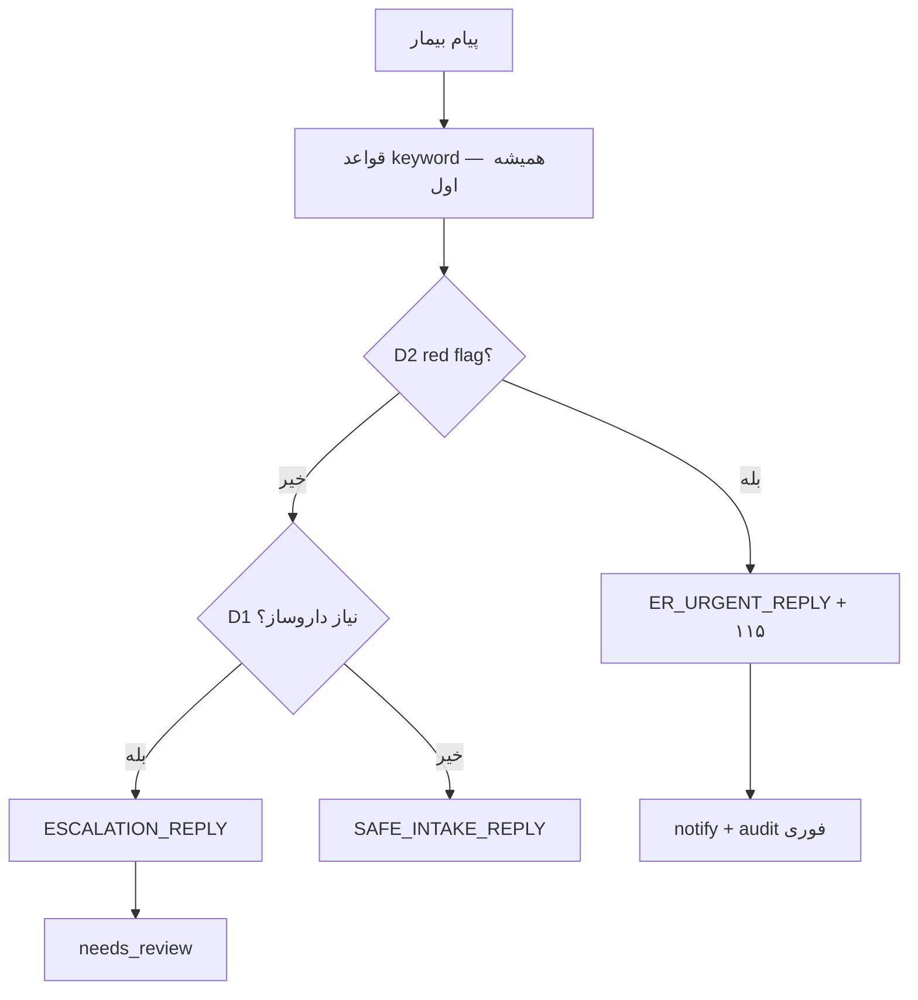
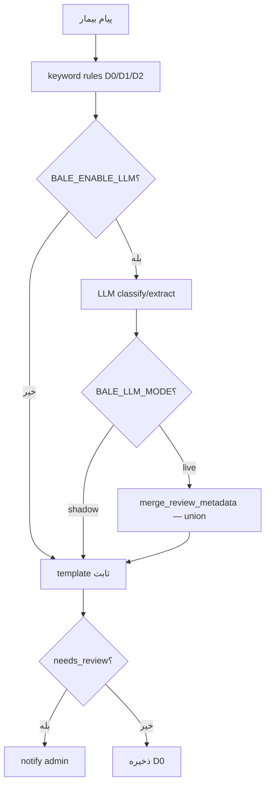

# طراحی تریاژ و ارجاع — بات داروخانه BaleMed (با/بدون LLM)

**مخاطب:** دکتر داروساز / صاحب داروخانه  
**وضعیت:** مرجع طراحی — Draft برای review  
**تاریخ:** 2026-07-18  
**پروژه:** BaleMed — Milestone 9

---

## ۱. خلاصه برای داروساز

بات BaleMed **دستیار دریافت پیام** است، نه پزشک و نه جایگزین داروساز.

| بات **می‌کند** | بات **نمی‌کند** |
|----------------|-----------------|
| پیام را ثبت می‌کند | تشخیص بیماری |
| اطلاعات ساختاریافته می‌خواهد | دوز، تداخل، شروع/قطع دارو |
| موارد پرریسک را به داروساز ارجاع می‌دهد | تصمیم اورژانس به‌عنوان مرجع پزشکی |
| پاسخ ثابت و تأییدشده می‌فرستد | پاسخ تولیدشده توسط LLM |

**تریاژ** در این سیستم یعنی: *قدم بعدی برای بیمار چیست؟* — نه «چه بیماری دارد».

---

## ۲. ADR پزشکی vs ADR فنی — اشتباه رایج

| مخفف | حوزه | معنی | مثال |
|------|------|------|------|
| **ADR (پزشکی)** | بالین / اورژانس | **Adverse Drug Reaction** — عوارض جانبی دارو | بیمار: «بعد از این قرص صورتم ورم کرد» |
| **ADR (فنی)** | نرم‌افزار | **Architecture Decision Record** — ثبت تصمیم طراحی | «چرا LLM فقط shadow است؟» |

در handoff اورژانس همسر شما (پزشک EM)، ADR = عوارض دارو.  
در repo و Notion BaleMed، ADR = سند تصمیم فنی (`docs/adr/`).

---

## ۳. تریاژ یعنی چه در داروخانه؟

### ۳.۱ تفاوت با تشخیص (Diagnosis)

- **تشخیص:** «بیمار چه بیماری دارد؟» — فقط پزشک/داروساز با صلاحیت.
- **تریاژ (Disposition):** «الان چه کار کند؟ در چه زمانی؟» — bot فقط **مسیر** پیشنهاد می‌دهد.

### ۳.۲ الگوی جهانی: NHS 111 (انگلستان)

[NHS 111 Online](https://digital.nhs.uk/services/nhs-111-online/nhs-111-online-is-a-class-1-medical-device) یک **Class 1 medical device** است که:

- از الگوریتم **rule-based** (NHS Pathways) استفاده می‌کند — نه LLM عمومی.
- **تشخیص نمی‌دهد** — فقط disposition: self-care، GP، اورژانس، آمبولانس.
- سوالات به ترتیب مشخص پرسیده می‌شود؛ خروجی = «قدم بعدی + بازه زمانی».

**درس برای BaleMed:** تریاژ = disposition، نه chatbot تشخیص‌ده.

### ۳.۳ الگوی Infermedica (5 سطح)

[Infermedica API](https://developer.infermedica.com/) در سیستم‌های بالینی از **۵ سطح** استفاده می‌کند:

1. Self-care  
2. Consultation  
3. Consultation 24h  
4. Emergency  
5. Emergency ambulance  

**درس:** BaleMed می‌تواند این را به **۳ سطح ساده** (D0/D1/D2) فشرده کند.

---

## ۴. سطوح disposition پیشنهادی BaleMed

| سطح | نام | معنی بالینی | پاسخ بیمار (template) | مسیر داخلی |
|-----|-----|-------------|----------------------|------------|
| **D0** | intake عادی | سوال دارویی ساده؛ بدون red flag | `SAFE_INTAKE_REPLY` | ذخیره؛ بدون review |
| **D1** | ارجاع داروساز | حساسیت، بارداری، دوز، کودک، عارضه، … | `ESCALATION_REPLY` | `needs_review` + notify admin |
| **D2** | red flag / اورژانس | تهدید فوری زندگی — ER/۱۱۵ | **`ER_URGENT_REPLY` (پیشنهادی — هنوز در کد نیست)** | bypass LLM؛ audit فوری؛ notify |

### ۴.۱ نگاشت کد فعلی → disposition

**امروز در [`app/replies.py`](../app/replies.py):**

- D0: پیام بدون keyword پرریسک → `SAFE_INTAKE_REPLY`
- D1 + D2: **هر دو** → `ESCALATION_REPLY` (یک template)

**گپ اصلی:** D2 (اورژانس) و D1 (داروساز) پاسخ یکسان دارند. برای red flag باید template جدا با تأکید بر **۱۱۵/ER فوری** باشد.



### ۴.۲ پیشنهاد red flags → D2

| کلمه/عبارت (فعلی در کد) | disposition |
|-------------------------|-------------|
| overdose، suicide، chest pain، shortness of breath، severe allergy | **D2** |
| اوردوز، خودکشی، درد قفسه سینه، تنگی نفس، حساسیت شدید | **D2** |
| allergy، pregnancy، child، dosage، side effect، … | **D1** |

### ۴.۳ نمونه پاسخ پیشنهادی D2 (طراحی — پیاده‌سازی آینده)

```text
پیام شما دریافت شد.
با توجه به علائمی که نوشتید، ممکن است نیاز فوری به مراقبت پزشکی باشد.
همین الان با اورژانس (۱۱۵) تماس بگیرید یا به نزدیک‌ترین اورژانس مراجعه کنید.
این ربات تشخیص نمی‌دهد و جایگزین پزشک نیست.
داروساز بعداً پرونده را هم بررسی خواهد کرد.
```

---

## ۵. ADR فنی #1 — مسیر **با LLM** (shadow → live)

**مرجع repo:** [`docs/adr/0003-triage-with-llm.md`](../adr/0003-triage-with-llm.md)

### ۵.۱ فلو



### ۵.۲ نقش LLM

طبق [`docs/SAFETY_RULES.md`](../SAFETY_RULES.md) و [`app/llm/types.py`](../app/llm/types.py):

- `needs_review` (boolean)
- `drug_name`, `main_question_topic`
- `risk_flags`: allergy، pregnancy_lactation، pediatric، urgent_symptoms، dose_interaction_mention
- `approximate_age_band`

**هرگز:** متن پاسخ به بیمار، تشخیص، دوز، triage اورژانس به‌عنوان مرجع.

### ۵.۳ Shadow vs Live

| حالت | routing | patient reply |
|------|---------|---------------|
| **shadow** | فقط keyword | template ثابت؛ LLM فقط ذخیره می‌شود |
| **live** | keyword **OR** llm.needs_review **OR** llm_fail | template ثابت؛ union — keyword downgrade نمی‌شود |

### ۵.۴ Fail-safe

در live mode: خطا، timeout، validation fail → `needs_review` + `review_reason=llm_fail_safe`.

### ۵.۵ Gate قبل از live

- 20–50 shadow message review (owner)
- ADR-0002: lexicon دارو یا structured intake
- [`docs/agents/HANDOFF.md`](../agents/HANDOFF.md)

---

## ۶. ADR فنی #2 — مسیر **بدون LLM** (rules-only)

**مرجع repo:** [`docs/adr/0004-triage-without-llm.md`](../adr/0004-triage-without-llm.md)

### ۶.۱ فلو

```text
پیام بیمار
  → keyword rules (D0 / D1 / D2)
  → (آینده) structured intake steps
  → پاسخ template بر اساس disposition
  → notify admin اگر D1 یا D2
```

### ۶.۲ مزایا

- **100% deterministic** — audit ساده
- بدون وابستگی API خارجی
- مناسب وقتی `BALE_ENABLE_LLM=false` یا LLM حذف شد

### ۶.۳ الگوی صنعتی

[GitHub: ai-healthcare-assistant](https://github.com/sadiqueamin-1999/ai-healthcare-assistant):

- موتور rule-based برای risk scoring
- LLM **فقط** برای language/summary — نه classification بالینی

[Hybrid clinical reasoning](https://ernest-bonat.medium.com/developing-and-deploying-hybrid-ai-clinical-reasoning-systems-d5afffb56583):

- urgent → **LLM bypass** + audit log

---

## ۷. طراحی پاسخ بیمار

### ۷.۱ اصول

1. **همیشه template ثابت** — هرگز LLM-generated text
2. **زبان ساده فارسی** — موبایل Bale
3. **مرز روشن:** bot تشخیص/دوز نمی‌دهد
4. **Safety netting:** در D1/D2 همیشه اشاره به ER/۱۱۵ برای علائم فوری

### ۷.۲ templateهای فعلی

| Template | فایل | disposition |
|----------|------|-------------|
| `SAFE_INTAKE_REPLY` | replies.py | D0 |
| `ESCALATION_REPLY` | replies.py | D1 (+ D2 امروز — باید جدا شود) |

---

## ۸. ADR پزشکی (عوارض دارو) — آینده PV

وقتی بیمار **عارضه دارویی** گزارش می‌کند (مثلاً «بعد از متفورمین → درد معده»):

- **الان:** ارجاع داروساز (D1) + `side effect` keyword
- **آینده (CAIDRA / pharma industry):** trigger **Pharmacovigilance (PV)** — فرم AE intake

[CAIDRA 14.3 — Medical information chatbots](https://pharmacystandards.org/caidra-examination/section-14-3-medical-information-chatbots-risks-and-controls/):

- chatbot باید AE را تشخیص دهد و به فرآیند PV ارجاع دهد — نه فقط پاسخ متنی.

---

## ۹. مقایسه با پروژه‌های جهانی

| پروژه/منبع | الگو | درس |
|------------|------|-----|
| NHS 111 / Pathways | Rule-based CDSS؛ disposition | تریاژ ≠ تشخیص |
| Cureus 2024 (AI vs NHS 111) | LLM عمومی پایدارتر از NHS نیست | LLM-only خطرناک |
| WHO LMM 2024 | human-in-the-loop؛ audit | هم‌راستا با shadow mode |
| CHART / JMIR | گزارش safeguards در chatbot studies | shadow review قبل live |
| Infermedica | 5-level triage API | الگوی disposition |
| ai-healthcare-assistant | rule engine + LLM language | نزدیک BaleMed |
| BaleMed ADR-0001/0002 | shadow؛ union؛ fail-safe | baseline فعلی |

---

## ۱۰. توصیه‌های عملی (۵–۷ مورد)

1. **Disposition D0/D1/D2 را formal کنید** — در CONTEXT و کد (`replies.py`).
2. **Template جدا برای D2** — red flags با ۱۱۵/ER صریح.
3. **LLM live نروید** تا shadow batch + lexicon/intake (ADR-0002).
4. **Keyword list را با داروساز review کنید** — S12 «سردرد شدید» حساسیت زیاد؟
5. **Structured intake** — نام دارو، سن، سوال اصلی (قبلاً در SAFE_INTAKE هست؛ formal flow آینده).
6. **PV workflow** — برای عوارض دارو در milestone بعد.
7. **هرگز ADR پزشکی و فنی را در یک سند قاطی نکنید.**

---

## ۱۱. منابع

1. [NHS 111 Online — Class 1 medical device](https://digital.nhs.uk/services/nhs-111-online/nhs-111-online-is-a-class-1-medical-device)
2. [NHS Pathways CDSS](https://digital.nhs.uk/services/nhs-pathways/nhs-pathways-is-a-class-1-medical-device)
3. [WHO — Ethics and governance of AI for health (LMMs)](https://www.who.int/news/item/18-01-2024-who-releases-ai-ethics-and-governance-guidance-for-large-multi-modal-models)
4. [Cureus 2024 — AI vs NHS 111 triage](https://doi.org/10.7759/cureus.97834)
5. [CAIDRA 14.3 — Medical information chatbots](https://pharmacystandards.org/caidra-examination/section-14-3-medical-information-chatbots-risks-and-controls/)
6. [Infermedica Developer API](https://developer.infermedica.com/)
7. [GitHub: ai-healthcare-assistant](https://github.com/sadiqueamin-1999/ai-healthcare-assistant)
8. BaleMed: [SAFETY_RULES.md](../SAFETY_RULES.md), [ADR-0001](../adr/0001-llm-shadow-mode.md), [ADR-0002](../adr/0002-clinical-trust-requirements-before-live-llm.md), [ADR-0003](../adr/0003-triage-with-llm.md), [ADR-0004](../adr/0004-triage-without-llm.md)

---

## پیوند Notion

- **Import:** [`docs/notion-import/README.md`](../notion-import/README.md) — script یا `/notion-os`
- Database: Knowledge — Category: Reference  
- Project: BaleMed  
- Tags: BaleMed, Pharmacy, Safety, LLM  
- Relation واژه_های_فنی: ADR (فنی), workflow, schema
